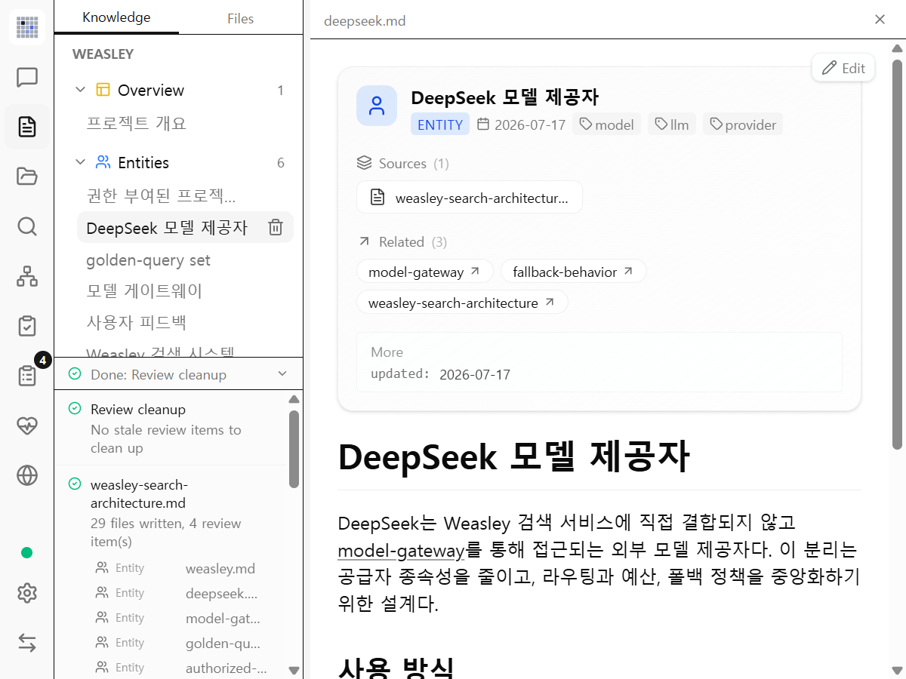
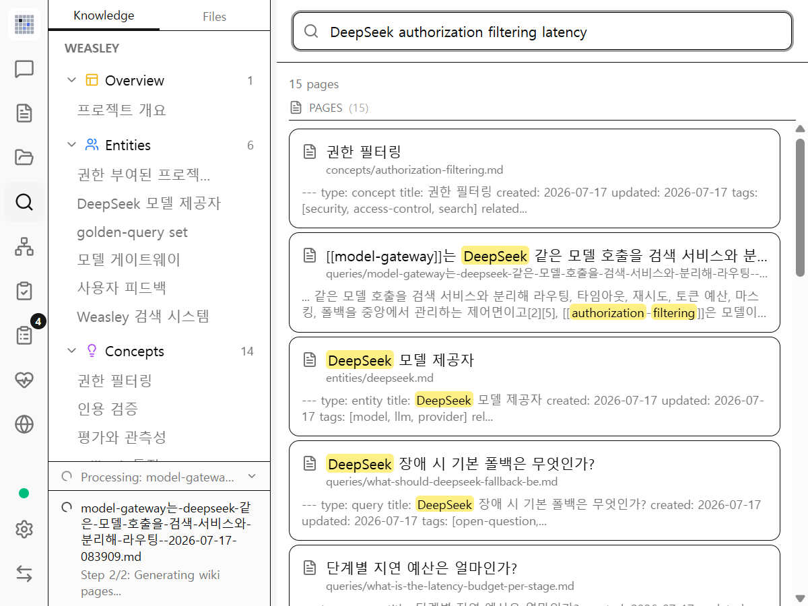
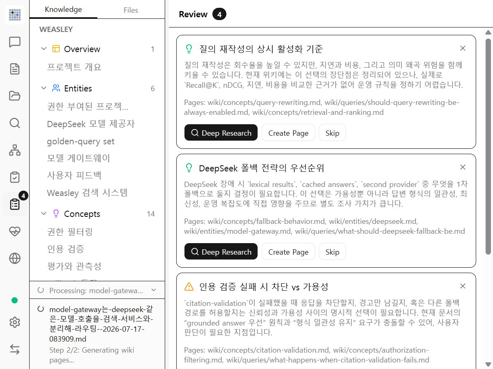
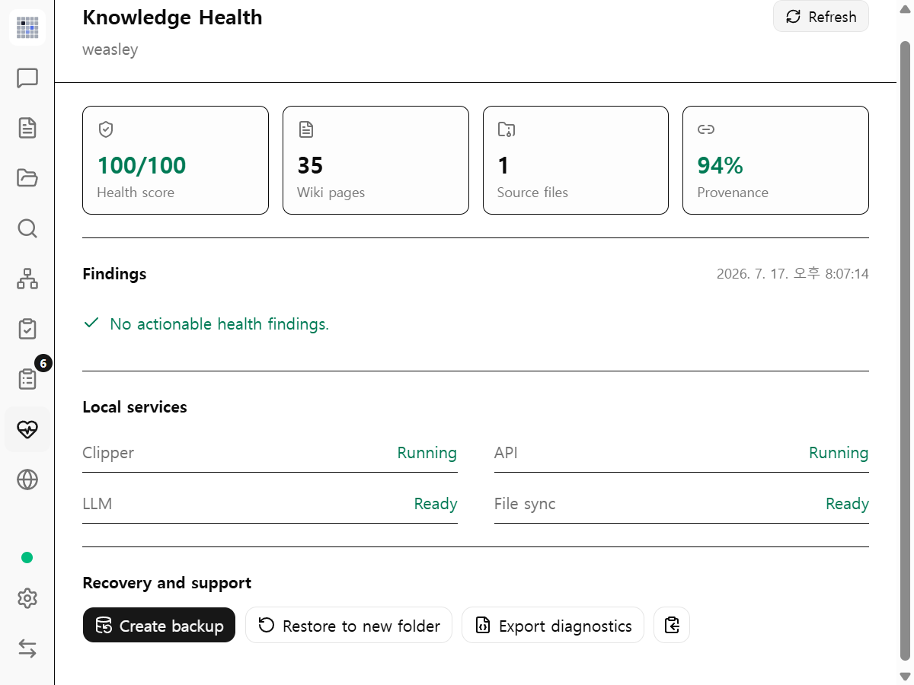

<p align="center">
  
</p>

<h1 align="center">potato box</h1>

<p align="center">
  <strong>Turn scattered sources into linked, inspectable knowledge.</strong>
</p>

<p align="center">
  A local-first AI workspace built on Markdown, explicit provenance, and human review.
</p>

<p align="center">
  <a href="https://github.com/potatohoney-p/potato_wiki_box/actions/workflows/ci.yml"></a>
  
  
  
  
</p>

<p align="center">
  English | <a href="README_KO.md">한국어</a> | <a href="README_CN.md">中文</a> | <a href="README_JA.md">日本語</a>
</p>

<p align="center">
  
</p>

potato box imports documents and web material, turns them into structured Markdown pages, and keeps the links, sources, review state, and operational history needed to trust the result. The project remains an ordinary folder that works with Git, Obsidian, scripts, and any editor you already use.

It is designed for durable research, not disposable chat. Conversations can use project context, while the lasting knowledge lives in files you can read, diff, repair, and move without potato box.

## What makes it different

| Local by default | Inspectable by design | Connected over time |
| --- | --- | --- |
| Sources, generated pages, chats, queues, and indexes live with the project. External calls happen only through features and providers you configure. | Knowledge is Markdown with YAML frontmatter, wikilinks, and provenance. Generated changes can be reviewed before they become durable project state. | Search, graph exploration, chat, deep research, lint, and health checks operate over the same project instead of creating isolated silos. |

## See the workspace

<p align="center">
  
</p>

<table>
  <tr>
    <td width="50%">
      
      <br><strong>Inspectable pages</strong><br>
      Read generated Markdown with its sources, tags, and related pages in view.
    </td>
    <td width="50%">
      
      <br><strong>Workspace search</strong><br>
      Combine keyword, graph, and optional vector retrieval.
    </td>
  </tr>
  <tr>
    <td width="50%">
      
      <br><strong>Human review</strong><br>
      Keep proposed changes visible until a person accepts or rejects them.
    </td>
    <td width="50%">
      
      <br><strong>Knowledge Health</strong><br>
      Check structure, links, provenance, duplicates, and recoverability.
    </td>
  </tr>
</table>

These are captures from the packaged desktop app using a synthetic QA project. See the [asset notes](assets/readme/README.md) for provenance and reuse guidance.

## How knowledge accumulates

<p align="center">
  
</p>

The graph is not a visualization of every chat sentence. A node represents a saved wiki page, and edges come from durable wikilinks and provenance. Ingest, research, editing, and approved changes turn ideas into pages; chat helps you reason over them. This distinction keeps the graph useful after a conversation ends.

## Core capabilities

| Area | What is included |
| --- | --- |
| Capture and ingest | Files, folders, browser clips, source-folder monitoring, a persistent queue, crash recovery, deduplication, incremental caching, and visible failed-task state |
| Document understanding | PDF and Office text extraction, embedded-image extraction, optional vision captioning, and guarded generation into typed pages |
| Knowledge workspace | Markdown editing, YAML frontmatter, wikilinks, provenance, automatic indexes, source pages, concepts, entities, queries, comparisons, and synthesis |
| Retrieval and reasoning | Keyword search, graph-aware retrieval, optional LanceDB vectors, explicit context budgets, project-grounded chat, and configurable deep research |
| Graph and insight | Interactive knowledge graph, filters, neighborhoods, community detection, and link-level navigation back to source pages |
| Quality and review | Review queue, semantic lint, broken-link and schema checks, duplicate detection, Knowledge Health, and redacted diagnostics |
| Reliability | Atomic durable writes, project-scoped state, cancellation-aware ingest, versioned backups, SHA-256 inventory validation, and restore into a new directory |
| Integrations | Authenticated localhost API, bundled MCP server, Chrome/Firefox-compatible clipper, Git-friendly files, and Obsidian-compatible projects |

## Provider choice

The language model, embedding model, document parser, and web search provider are configured independently.

- Use hosted APIs or OpenAI-compatible and Anthropic-compatible endpoints.
- Use local endpoints such as Ollama, LM Studio, llama.cpp, vLLM, or LocalAI.
- Reuse an authenticated local Codex CLI or Claude Code CLI installation without adding another API key.
- Add optional semantic search through OpenAI-compatible, Gemini, or Volcengine-compatible embeddings.
- Configure web research separately; ordinary ingest, editing, search, and graph use do not require a web-search provider.

Provider settings are saved in the app's local preferences and restored on the next launch. Project Markdown does not contain API keys. See [Privacy](docs/PRIVACY.md) before processing sensitive material: local-first does not mean that configured provider requests stay on-device.

## Install

Tagged releases publish these artifacts:

| Platform | Artifacts |
| --- | --- |
| Windows x64 | NSIS `.exe` and MSI `.msi` |
| macOS Apple Silicon | `.dmg` |
| Linux x64 and ARM64 | AppImage and `.deb` |
| Chromium/Firefox-compatible browsers | Browser clipper ZIP attached to the release |

Download the artifact for your platform from [GitHub Releases](https://github.com/potatohoney-p/potato_wiki_box/releases). Verify the release notes and exercise backups before upgrading a project you cannot recreate.

### Build from source

Requirements:

- Node.js 20 or newer
- Rust stable with `rustfmt` and `clippy`
- Protocol Buffers compiler (`protoc`)
- The [Tauri 2 platform prerequisites](https://v2.tauri.app/start/prerequisites/) for your operating system

```bash
npm ci
npm ci --prefix mcp-server
npm run tauri dev
```

The browser-only shell is available with `npm run dev`, but native filesystem, backup, vector, API, MCP, and clipper behavior requires Tauri.

Build distributable bundles:

```bash
npm run build
npm run tauri build
```

Windows contributors can use the standard MSVC Build Tools setup or the documented LLVM/xwin path in [CONTRIBUTING.md](CONTRIBUTING.md).

## First project

1. Select **Create Project**, choose a parent directory, and define the project's purpose.
2. Open **Settings -> AI Providers**, choose a hosted, compatible, local, or CLI provider, then run its connection test.
3. Add material from **Sources** or place files under `raw/sources/`.
4. Let the persistent ingest queue create pages, links, indexes, and provenance.
5. Ask a project-grounded question, follow its page references, and inspect the resulting graph neighborhood.
6. Resolve review items and lint findings, then open **Knowledge Health**.
7. Create a backup before a large import, migration, or provider change.

Deep Research is optional. If it reports that sources are not configured, add a web-search or AnyTXT provider under **Settings -> External Information Sources**, or continue using the rest of the workspace without Deep Research.

## Project format

```text
my-project/
|-- purpose.md
|-- schema.md
|-- raw/
|   |-- sources/
|   `-- assets/
|-- wiki/
|   |-- index.md
|   |-- log.md
|   |-- entities/
|   |-- concepts/
|   |-- sources/
|   |-- queries/
|   |-- comparisons/
|   |-- synthesis/
|   `-- media/
`-- .potato-box/
    |-- chats/
    |-- clip-queue/
    |-- clip-receipts/
    |-- lancedb/
    |-- migrations/
    |-- recovery/
    |-- trash/
    `-- application state and caches
```

Markdown and imported sources are the durable source of truth. LanceDB is a rebuildable index; `.potato-box` contains project-scoped operational state. Opening a compatible legacy project migrates its application state without deleting the old data before a successful move or copy.

## Automation and integrations

### Local API and MCP

The desktop app can expose `http://127.0.0.1:19828/api/v1` for local automation. Every non-health request requires `X-Potato-Box-Token` or a Bearer token. Public project IDs are UUIDs, `current` is the only alias, and filesystem paths are never accepted as API project IDs.

The bundled MCP server forwards calls to this API, preserving the same project registry, retrieval rules, and file allow-list. Available tools cover status, projects, files, review items, search, graph data, and source rescans. See the [MCP server guide](mcp-server/README.md) and [API reference](docs/API.md).

### Browser clipper

Load `extension/` as an unpacked extension or use the ZIP attached to a tagged release. Configure the API token and a project UUID from **Settings -> API + MCP**. Capture uses bounded requests, collision-safe filenames, durable pending markers, and idempotency receipts so a timed-out retry does not create a duplicate clip.

## Data, privacy, and recovery

- Project content and project-scoped operational state stay in the selected folder.
- App-wide preferences live in the operating system's Tauri application-data directory.
- Content may leave the device when you use a configured LLM, embedding, search, vision, parsing, or update service.
- Diagnostics redact recognized secret fields and omit source bodies by default, but should still be inspected before sharing.
- Backups contain a versioned manifest with each file's size and SHA-256 digest; restore validates the full inventory before installing a re-keyed project into a new directory.
- Local API and clipper listeners bind to loopback, but tokens remain mandatory because localhost is not an authentication boundary.

Read [Privacy](docs/PRIVACY.md), the [Threat model](docs/THREAT_MODEL.md), and the [Security policy](SECURITY.md) before exposing integrations or handling sensitive data.

## Development and quality

potato box is a Tauri 2 desktop application with a React 19/TypeScript frontend and a Rust backend. The frontend owns interaction and project-scoped views; Rust remains authoritative for filesystem access, extraction, backup/restore, vector storage, and local services. See [Architecture](docs/ARCHITECTURE.md).

```bash
npm run typecheck
npm test
npm run build
cargo fmt --manifest-path src-tauri/Cargo.toml -- --check
cargo clippy --manifest-path src-tauri/Cargo.toml --lib -- -D warnings
cargo test --manifest-path src-tauri/Cargo.toml --lib
```

`npm test` runs frontend mock tests, MCP tests, and documentation-link checks. External-provider tests are intentionally opt-in because they can use credentials and incur cost:

```bash
npm run test:real
```

## Contributing

Start with [CONTRIBUTING.md](CONTRIBUTING.md). Changes that affect the project format, security boundaries, provider contracts, or migrations should include tests and an explicit compatibility note. For vulnerabilities, follow [SECURITY.md](SECURITY.md) instead of opening a public exploit report.

Additional project documents:

- [Changelog](CHANGELOG.md)
- [Governance](GOVERNANCE.md)
- [Release process](docs/RELEASING.md)
- [Brand and asset guide](docs/BRAND.md)

## License and acknowledgements

potato box is licensed under the GNU General Public License v3.0 only. See [LICENSE](LICENSE) for the complete terms and [NOTICE](NOTICE) for required provenance and third-party acknowledgements.
