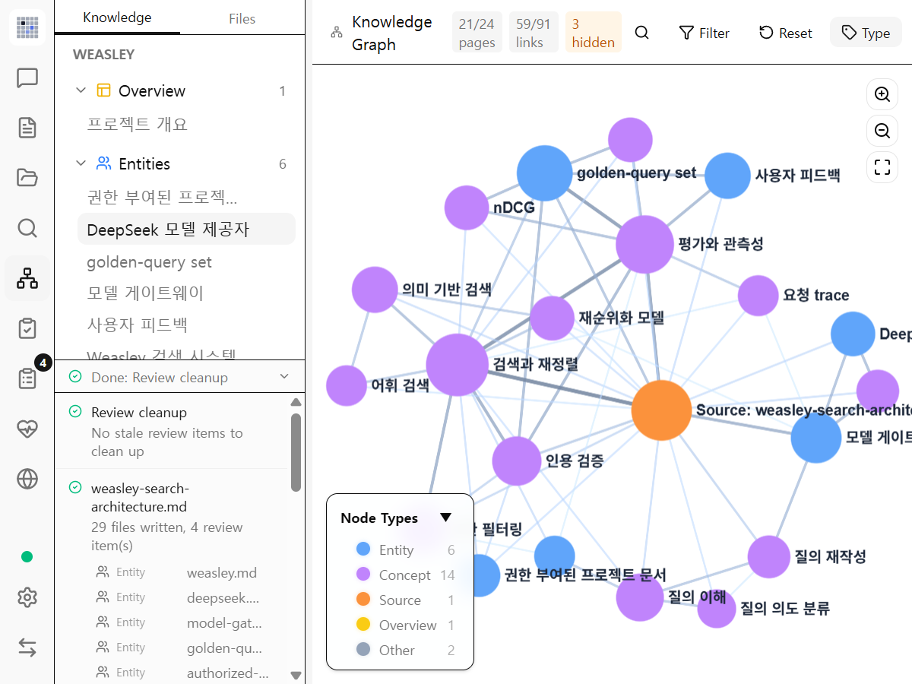
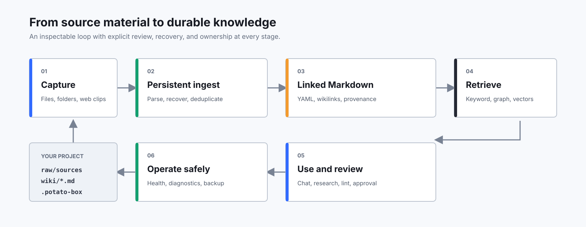

<p align="center">
  
</p>

<h1 align="center">potato box</h1>

<p align="center"><strong>資料を検査可能なナレッジベースへ変換する、ローカル優先の AI ワークスペース。</strong></p>

<p align="center">
  <a href="https://github.com/potatohoney-p/potato_wiki_box/actions/workflows/ci.yml"></a>
</p>

<p align="center"><a href="README.md">English</a> | <a href="README_KO.md">한국어</a> | <a href="README_CN.md">中文</a> | 日本語</p>

<p align="center">
  
</p>

potato box は文書を取り込み、構造化された Markdown ページ、リンク、出典を維持します。検索、レビュー、Knowledge Health、バックアップと復元を備え、プロジェクトは Git、Obsidian、一般的な Markdown ツールでそのまま利用できます。



## 主な機能

- 永続化された取り込みキュー、クラッシュ復旧、差分キャッシュ、ソース監視
- PDF/Office のテキスト・画像抽出と任意の画像キャプション
- Markdown、YAML frontmatter、wikilink、出典追跡
- キーワード、グラフ、任意の LanceDB ベクトル検索
- Deep Research、Review、Lint、Knowledge Health
- ZIP バックアップ、新規フォルダーへの安全な復元、秘匿化された診断出力
- トークン必須の localhost API、MCP Server、ブラウザークリッパー



## 開発開始

Node.js 20 以降、Rust stable、`protoc`、OS ごとの [Tauri 2 前提条件](https://v2.tauri.app/start/prerequisites/)が必要です。

```bash
npm ci
npm run tauri dev
```

リリースビルド：

```bash
npm run build
npm run tauri build
```

## セキュリティ

ローカル API は `127.0.0.1` のみに bind しますが、`X-Potato-Box-Token` または Bearer token を必須とします。公開プロジェクト ID は UUID で、別名は `current` のみです。ファイルシステムパスは API ID として受け付けません。

## ドキュメント

- [Architecture](docs/ARCHITECTURE.md)
- [Local API reference](docs/API.md)
- [Threat model](docs/THREAT_MODEL.md)
- [Privacy](docs/PRIVACY.md)
- [Contributing](CONTRIBUTING.md)
- [Security](SECURITY.md)

## ライセンスと由来

potato box は GNU GPL v3.0 で配布されます。全文は [LICENSE](LICENSE)、保持すべき由来と第三者表記は [NOTICE](NOTICE) を参照してください。
