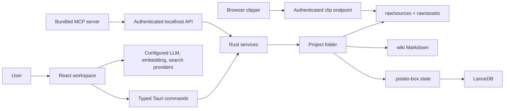
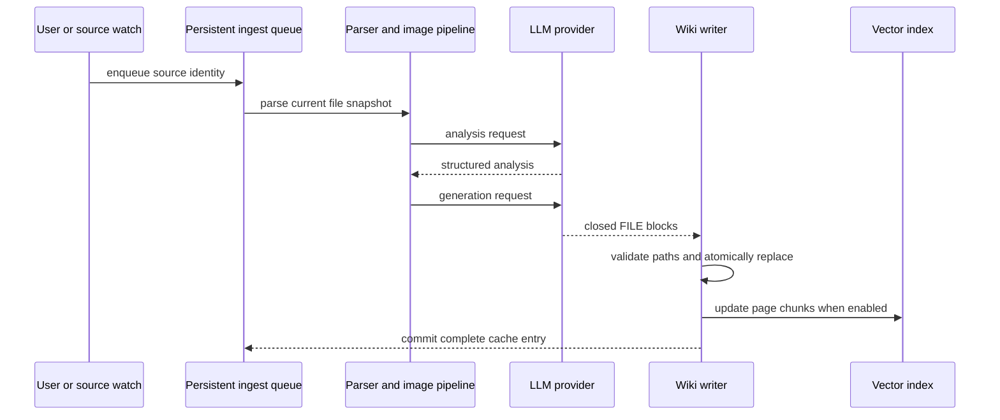

# Architecture

## System Shape

potato box is a Tauri 2 desktop application with a React/TypeScript webview and a Rust backend. Markdown project folders are the durable source of truth; JSON state and LanceDB indexes are derived or operational state.

## Frontend Boundaries

- `src/components`: user-facing views and reusable controls.
- `src/stores`: Zustand state; project-scoped stores must reset during project switches.
- `src/lib`: ingest, persistence, retrieval, migration-compatible data helpers, and provider clients.
- `src/commands`: narrow IPC wrappers; Rust remains authoritative for filesystem and native services.
- Major workspace views are lazy-loaded so graph, editor, settings, and health dependencies do not block initial rendering.

## Rust Boundaries

- `commands/project.rs`: project creation/open validation and dynamic asset-protocol scope.
- `commands/fs.rs`: native reads/writes, extraction, and atomic replacement.
- `commands/vectorstore.rs`: LanceDB operations and project-specific locks.
- `commands/backup.rs`: bounded ZIP creation and guarded restore.
- `api_server.rs`: authenticated automation API with public project summaries.
- `clip_server.rs`: extension-origin capture endpoint and durable acknowledgement queue.
- `migration.rs`: legacy application/project state migration.
- `file_sync.rs`: external source changes and deletion revalidation.

## Ingest Flow

The queue permits one active runner epoch. Cancellation does not start another runner until the previous runner settles. Cache entries are committed only for complete, non-empty generations.

## Persistence

- Project content: Markdown and imported source files.
- Operational state: `.potato-box/*.json`, written atomically.
- Conversations: `.potato-box/chats/<safe-id>.json`.
- Pending clips: one durable marker per clip until acknowledgement, plus a 30-day idempotency receipt for response-loss retries.
- Vector data: `.potato-box/lancedb`; it can be rebuilt from Markdown.
- Backups: ZIP outside the project with a versioned complete-file inventory, per-file size, and SHA-256 verification before restore.
- Failed app-data migrations: persisted report plus a blocking, retryable startup state before settings are hydrated.

## Compatibility Rules

- Read legacy formats only where a migration path is explicit.
- Write the current `.potato-box` format only.
- Never silently discard a legacy directory after a partial migration.
- Treat project paths as native-only data; API/MCP surfaces use UUIDs.
